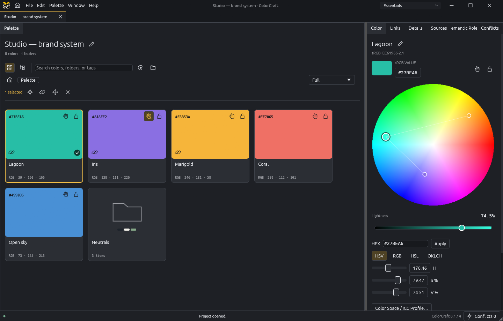
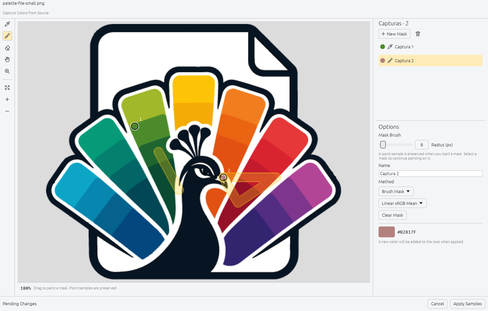
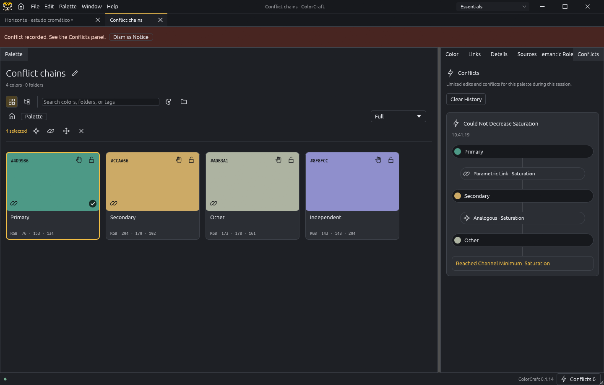

<p align="center"></p>

# ColorCraft

**Build a palette that keeps its relationships.**

ColorCraft is a standalone application for **parametric color palette engineering**. Define how colors relate, explore changes, protect important values, and publish the resulting palette for other applications to use.

A brand color changes. Its related hues follow. A text/background pair reaches its contrast limit. A reference color stays fixed. The palette carries the reasoning behind its colors, so you can revise the system without rebuilding it swatch by swatch.

[Getting started](#getting-started) · [Install](#install) · [Build](#build-from-source) · [Roadmap](ROADMAP.md) · [ArtCraft proposal](docs/ARTCRAFT-PROPOSAL.md)



*The included [Studio example](examples/Studio.colorcraft): Lagoon, Iris and Marigold share hue relationships; Iris follows related edits while direct editing is protected.*

## Our goals

1. **Be a standalone tool for parametric palette engineering.** Useful on its own, with local files, explicit rules and a complete editing workflow.
2. **Generate and dynamically edit palettes that other programs on the computer can use.** Keep the editable color system in ColorCraft and publish its resolved colors through documented formats and interfaces.

**Full integration with the ArtCraft applications is a central goal within the second objective.** Its scope and implementation will follow decisions by the ArtCraft team. ColorCraft is currently an independent project being prepared for consideration; it is not an official suite application.

## The philosophy

**A palette is a system, not just a list of HEX values.** Relationships express what should remain coherent when a color changes. Constraints express what must remain valid. Locks express what must remain fixed.

**Meaning and mathematics are separate.** A technical relationship changes color values. A semantic role such as `text.primary` explains a color's job; modes associate that role with different colors. Documentary relationships record intent without changing values.

**The user stays in control.** Edits are undoable. A conflict explains the chain that stopped an operation. Source updates and integration revisions require explicit acceptance. Native color values and ICC data remain separate from the display preview.

**The palette belongs to the user.** Work locally without an account. Keep an editable `.colorcraft` project, export ordinary palette formats, and let another application consume a published snapshot without opening the editor.

## What you can do today

| Capability | What it gives you |
|---|---|
| Parametric links | Connect RGB/HSV channels across two or more colors, preserving ratios or offsets and allowing edits from different participants. |
| Harmonies and gradients | Generate related colors—including regular-polygon Geometry harmonies—and discrete ramps with sRGB, OKLab or OKLCH interpolation. |
| Limiting links | Constrain an opaque sRGB pair by minimum WCAG contrast. Invalid numeric edits are rejected; constrained drags stop at the boundary. |
| Two kinds of protection | Fix a color completely, or block direct editing while allowing changes through its relationships. |
| Explainable conflicts | Follow a chain of colors and relationships to the blocker; remove a relationship while preserving its colors. |
| Source capture | Sample PNG, JPEG, WebP, TIFF, PDF and SVG using points, area statistics or painted masks. Keep captures editable and linked to their source colors. |
| Organization and meaning | Folders, grid/tree views, tags, custom metadata, semantic roles and modes. |
| Native color data | sRGB, Display P3, Lab D50, gray and CMYK, with ICC data retained and explicit conversion choices. |
| Reusable output | Local publication, autosave, recovery drafts, and palette/JSON/CSS/DTCG/GPL/Simple Color Palette/CSV/SVG exports. |

Current parametric links use the built-in channel rules. **User-authored formulas and variables are planned**, as described in the [roadmap](ROADMAP.md#user-defined-parametric-relations).

## Example use cases

| Workflow | How ColorCraft helps |
|---|---|
| **A brand changes its primary hue** | Link related accents, preserve chosen neutrals, and explore the new family together. Publish the accepted palette for downstream work. |
| **A UI needs light and dark color assignments** | Define roles such as `text.primary` and `surface.canvas`, associate colors by mode, and constrain relevant text/background pairs. |
| **An illustrator needs consistent tonal ramps** | Create related shades and gradient samples, then adjust the source colors instead of recreating every swatch. |
| **A palette starts from visual references** | Capture a pixel, a neighborhood or a painted region; revisit the sampling method later and update only the linked color. |
| **A developer needs usable design tokens** | Document names and roles, then export CSS or DTCG alongside the editable project. Consumers must implement any ColorCraft-specific extensions they need. |

Contrast checks apply to the configured color pairs; they do not certify an entire interface's accessibility.

<details>
<summary><strong>See capture and conflict explanations</strong></summary>



*Capture from a point or a painted region. Apply commits the draft as one undoable operation.*



*A refused change has an explanation: follow the chain to the limiting channel or locked value.*

</details>

## Getting started

1. Create a palette, or open [`examples/Studio.colorcraft`](examples/Studio.colorcraft).
2. Add colors and folders. Use cards for browsing or the tree for hierarchy.
3. Select colors with Ctrl and create a parametric link, a limiting link or a harmony. Choose only the channels you want to connect.
4. Edit a participating color. Related values follow where the rules permit it. Inspect **Links** and **Conflicts** to understand the result.
5. Add roles and mode assignments when you need to describe how colors should be used. These associations do not recolor the palette.
6. Save the `.colorcraft` project. ColorCraft also publishes a resolved snapshot to the local library; export other formats as needed.

The **hand** protects against direct edits but permits relationship-driven changes. The **padlock** fixes the value completely. Source-linked colors are protected; unlocking them requires confirmation and detaches the capture link while keeping the current value.

In **Sources**, add a file and double-click it to open capture. Use the eyedropper, independent masks, stroke eraser, hand and zoom tools. Files are linked by default, with an explicit embed option. **Apply** commits the draft; **Cancel** discards it.

See the [product guide](docs/PRODUCT-GUIDE.md) for the basic workflow and the [format contract](docs/FORMATOS.md) for interoperability details. The interface is available in English and Brazilian Portuguese.

## Integration: current experiment and future direction

ColorCraft saves editable rules in `.colorcraft` files and publishes resolved palette snapshots to the per-user Windows library:

```text
%APPDATA%\ArtCraft\Palettes\library.json
```

“Published” currently means **available locally to this Windows user**, not uploaded to the internet. Normal saves and autosaves update the library. Other programs can read snapshots without modifying the project.

The separate [VectorCraft integration PoC](https://github.com/EduMzz/vectorcraft-colorcraft) explores palette discovery, linked document swatches, explicit revision acceptance, exact `colorcraft://` navigation and confirmed color submission through a local file queue. The [bridge contract](docs/BRIDGE-v1.md) documents this experiment. It is not an adopted suite-wide protocol.

The initial application proposal concerns **ColorCraft only**. Production integrations in VectorCraft and other ArtCraft applications will be proposed separately, according to the team's decisions. Semantic-role resolution in clients, shared cloud palettes and cross-device collaboration are roadmap topics.

## Install

**Current preview target: Windows x64.** See [Releases](https://github.com/EduMzz/ColorCraft/releases) for published packages; if no preview is available there yet, build from source below.

1. Extract the **entire portable ZIP** into a writable folder and open `ColorCraft.exe`.
2. Keep `ColorCraftData` when updating: it contains portable preferences and recovery data. Save projects in a location of your choice.
3. Optionally run `Register-ColorCraftFiles.ps1` from that folder to register project/palette icons and file associations for the current Windows user.
4. For the integration experiment, run `Register-ColorCraftProtocol.ps1` to register `colorcraft://`. Re-register after moving the portable folder.

No browser, Node.js, Python, account or Rust installation is needed to run the packaged application. The Windows package includes PDFium and dependency notices. Verify the downloaded ZIP against its `.sha256` file. Launcher distribution, signed installers and additional operating systems remain adoption/release work, not current download options.

## Build from source

On a **Windows x64 MSVC host**, install Git, Rust 1.95 or newer, and Visual Studio Build Tools with the C++ toolchain and Windows SDK. An OpenGL-capable graphics driver is required to run the desktop UI.

```powershell
git clone https://github.com/EduMzz/ColorCraft.git
cd ColorCraft
cargo build --locked --release -p colorcraft
powershell -File tools/fetch-pdfium.ps1 -Destination target/release
./target/release/colorcraft.exe
```

To build a portable package with examples, the pinned PDFium runtime, licenses and checksums:

```powershell
powershell -File tools/package.ps1
```

The package script preserves existing output folders; use `-OutputTag preview-2` for another evaluation build of the same version. See [development](docs/DEVELOPMENT.md) for checks, architecture and platform limits.

## Roadmap and contribution

The next major direction is **granular, user-defined parametric relationships using formulas and named variables**. Community workflow research will guide the design. ArtCraft integration and cloud/shared/multidevice capabilities will be developed according to later team decisions. See the [roadmap](ROADMAP.md) and [contribution guide](CONTRIBUTING.md).

**Status: functional preview, version 0.1.14.** Windows x64 is the evaluated desktop target. The core can be checked for WebAssembly; a browser application and cross-platform desktop packages are not delivered yet. The screen uses an sRGB preview; physical monitor/print calibration is not guaranteed. The built-in generic CMYK profile is synthetic; use the actual output profile for production work. Unsupported profiles require an explicit choice or conversion, rather than a silent claim of fidelity.

## License and provenance

Original code is **MIT OR Apache-2.0**. ColorCraft uses pinned `craft-ui`, `craft-cms`, `craft-settings` and `craft-atomic` libraries, plus egui/eframe and other credited dependencies. See [NOTICE.md](NOTICE.md), [LICENSE-MIT](LICENSE-MIT) and [LICENSE-APACHE](LICENSE-APACHE).

Images and icons have separate provenance and terms in [ASSETS.md](ASSETS.md). The repository's code license does not automatically relicense the supplied illustrations. ArtCraft adoption, branding, maintenance responsibilities and release readiness remain subject to team review; see the [application proposal](docs/ARTCRAFT-PROPOSAL.md).
